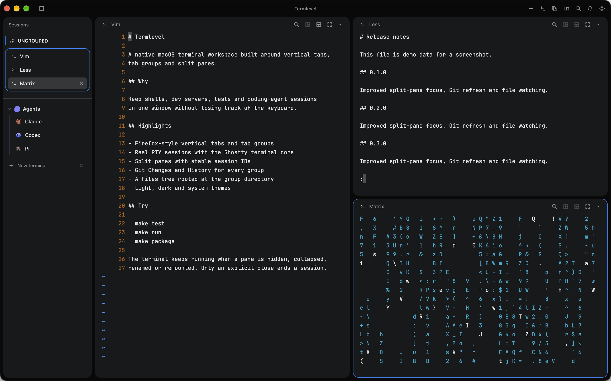

# Termlevel

Termlevel is a native macOS terminal workspace built with Native Shell. It brings shells, development servers, tests and coding-agent sessions into one window, organized with Firefox-style vertical tabs, tab groups and split panes.

## Sessions, tabs and groups

Vertical tabs make a long session list readable, and groups keep related work together. Each group has a name, a directory and one of nine colors, with an inline editor for renaming, recoloring and managing the group. Tabs can be pinned, reordered and moved between groups, and opening a terminal inside a group starts it in that group's directory.

A session keeps its identity when a tab is moved, a group is collapsed, the split layout changes or a view is remounted. A terminal that is hidden or collapsed keeps running, and only an explicit close ends its process. The workspace structure, split layout, fonts, scrollback limit and appearance are restored on restart, with new shells in the saved directories.

## Split panes

A window can show several terminals at once. Panes split to the right or down, take existing sessions, resize from the divider or the keyboard, equalize their sizes and zoom one pane temporarily. Directional shortcuts move focus and swap sessions between positions.

Panes are mounted by session ID, so rearranging the layout does not recreate terminals or lose their input, selection and scroll state. When the window is too narrow for the full layout, Termlevel shows the focused pane and restores the complete layout when space returns.

## The terminal

Terminal streams, parsing, grids and high-frequency rendering run in Rust. Sessions use the official Ghostty 1.0.1 terminal core through an independent memory-safe wrapper, with real PTY processes.

The native surface supports system input methods, bracketed paste, mouse reporting, focus reporting, alternate-screen applications, truecolor and ANSI palettes. It provides word and line selection, cross-screen drag selection, a history scrollbar and find-in-terminal over scrollback. OSC 8 links open from the terminal, Kitty inline images render in place, and OSC 52 integrates with the system clipboard. Synchronized output avoids partial frames.

Bundled JetBrains Mono and Sarasa Term SC cover programming ligatures and Chinese text without extra font installation.

## Session awareness

Terminal titles and live working directories come from OSC 0, OSC 2 and OSC 7. Programs can report desktop-style notifications, real progress and program status, all surfaced on the tab and in the window's notification history. Idle Claude Code, Codex, Grok, Pi and OpenCode sessions show their product icons in the sidebar.

## Git

Each group has Changes and History views. Changes shows the working tree, a changed-file tree and per-file diffs. History shows commit lanes, commit details and patches, branches, remotes, tags and worktrees, with fetch, fast-forward pull, push, checkout, branch management and worktree management.

Repository discovery follows the group directory and the terminal's live working directory, with a searchable repository picker and a remembered selection for each group.

## Files

The Files view browses the group directory, expands folders on demand and edits UTF-8 text files with syntax highlighting. Saves are explicit, unsaved changes are protected, and file rows carry the same Git status letters as Changes. The editor can show new, modified and deleted lines relative to HEAD.

Files can reveal an item in Finder, open it with the default app, copy its path, open a terminal at its location or move it to Trash after confirmation. Expanded folders update from the file system while the view is open.

## Appearance

Termlevel uses a unified window bar with rounded sidebar and terminal surfaces. Light, dark and system appearances share semantic theme tokens, and a group's color appears in its marker, guide line and selected terminal icon.

Settings cover the color theme, working indicator, interface font, terminal font and size, scrollback limit and shortcuts. Switching appearance never recreates a terminal.

[GitHub repository](https://github.com/biuld/termlevel)
